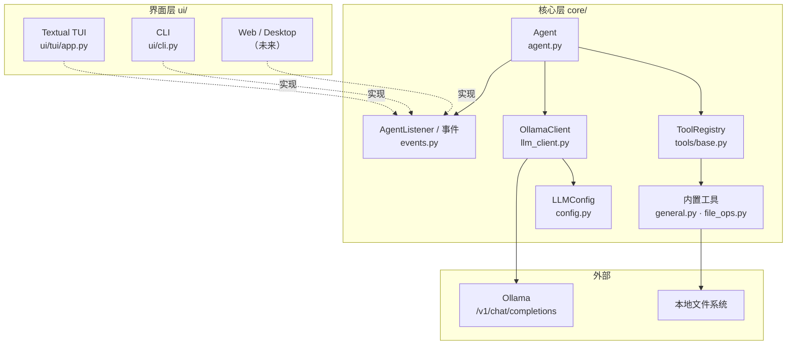

# OCCAgent — 分层架构的本地智能体

基于 Ollama + Function Calling 的本地智能体。在 Practice02 的基础上完成 **核心层与界面层分离**，内置 Textual TUI 与纯文本 CLI，并为 Web / Desktop 等新界面预留扩展点。

## 目录结构

```
OCCAgent/
├── main.py                    # 统一入口：组装依赖 + 选择界面
├── requirements.txt
├── core/                      # 核心层（零 I/O，零 UI 依赖）
│   ├── config.py              # LLMConfig：地址/模型/超时，支持环境变量
│   ├── events.py              # 领域事件 + AgentListener 协议
│   ├── llm_client.py          # Ollama 客户端：流式解析，只产出事件
│   ├── agent.py               # Agent 编排：历史管理 / 工具执行 / 事件派发
│   └── tools/
│       ├── base.py            # Tool 抽象 + ToolRegistry（装饰器注册）
│       ├── general.py         # getDate / isLeapYear
│       └── file_ops.py        # 10 个本地文件操作工具
└── ui/                        # 界面层（可替换）
    ├── base.py                # BaseUI 契约
    ├── cli.py                 # 纯文本界面
    └── tui/
        └── app.py             # Textual 终端界面
```

## 分层架构



**依赖方向严格单向**：`ui → core`，核心层不 import 任何界面代码，也不调用 `print` / `input`。

## 事件契约

核心层把运行过程表达为事件，界面层只需实现一个方法：

```python
class AgentListener(Protocol):
    def on_event(self, event: AgentEvent) -> None: ...
```

| 事件 | 触发时机 | 界面层典型处理 |
|------|----------|----------------|
| `TextDelta(text)` | 模型流式输出片段 | 追加到流式区域 |
| `ToolCallStarted(call_id, name, arguments)` | 即将执行工具 | 展示调用信息 |
| `ToolCallFinished(call_id, name, result)` | 工具执行完毕 | 展示结果 |
| `AssistantMessage(text)` | 本轮最终回复 | 落盘到消息列表 |
| `ErrorRaised(message)` | 连接/协议错误 | 错误提示 |

## 运行

```powershell
cd d:\Downloads\VScode\Project\LLM-Course\Agent\OCCAgent
pip install -r requirements.txt

python main.py            # Textual TUI（默认）
python main.py --ui cli   # 纯文本 CLI
```

**前置条件**：Ollama 已启动（`http://localhost:11434`），并已拉取 `qwen3-vl:4b-instruct`。

### 环境变量

| 变量 | 默认值 | 说明 |
|------|--------|------|
| `OCCAGENT_BASE_URL` | `http://localhost:11434` | Ollama 地址 |
| `OCCAGENT_MODEL` | `qwen3-vl:4b-instruct` | 模型名 |
| `OCCAGENT_TIMEOUT` | `120` | 请求超时（秒） |

### TUI 快捷键

| 按键 | 功能 |
|------|------|
| `Enter` | 发送问题 |
| `Ctrl+L` | 清空对话并重置上下文 |
| `Ctrl+Q` / `Ctrl+C` | 退出 |

## 工具

| 类别 | 工具 | 说明 |
|------|------|------|
| 通用 | `getDate` | 本地 `date/time` 命令获取日期时间 |
| 通用 | `isLeapYear` | 闰年判断 |
| 文件 | `getCwd` | 当前工作目录 |
| 文件 | `listDir` | 列目录（可递归） |
| 文件 | `getFileType` | 扩展名 / MIME / 是否文本 |
| 文件 | `readFile` | 读取纯文本（utf-8/gbk/utf-16 自动回退） |
| 文件 | `createFile` | 创建文件（自动建父目录） |
| 文件 | `writeFile` | 覆盖或追加写入 |
| 文件 | `createDir` | 递归创建目录 |
| 文件 | `deleteDir` | 删除非空目录（危险路径保护） |
| 文件 | `deleteFile` | 删除文件 |
| 文件 | `renamePath` | 重命名文件 / 目录 |

新增工具只需在 `core/tools/` 中注册：

```python
@registry.tool(
    name="myTool",
    description="工具用途，模型据此决定是否调用",
    parameters={"type": "object", "properties": {...}, "required": [...]},
)
def my_tool(arg: str) -> str:
    return "结果文本"
```

## 扩展新界面

以 Web 为例，核心层不需要任何修改：

1. `ui/web/app.py` 中实现 `AgentListener`，把事件推送到 SSE / WebSocket；
2. 继承 `BaseUI`，在 `run()` 中启动 Web 服务；
3. 用户消息交给 `agent.ask(text)`（建议放入后台线程，避免阻塞请求循环）；
4. 在 `main.py` 的 `--ui` 选项中注册 `web`。

Desktop（PySide/Tkinter）同理，仅需把事件映射为窗口控件更新。

## 与 Practice02 的差异

| 项 | Practice02 | OCCAgent |
|---|---|---|
| 结构 | 单文件 `chat.py` | `core/` + `ui/` 分层 |
| 输出方式 | 核心内直接 `print` | 事件驱动，UI 自行渲染 |
| 界面 | 固定命令行 | TUI / CLI 可切换，可扩展 |
| 工具注册 | 手写 `TOOL_MAP` | 装饰器注册，schema 与实现同处 |
| 配置 | 硬编码常量 | `LLMConfig` + 环境变量 |
| 流式响应 | 直接打印 | `TextDelta` 事件增量渲染 |
| 线程模型 | 主线程阻塞 | Agent 在 worker 线程，UI 不冻结 |
